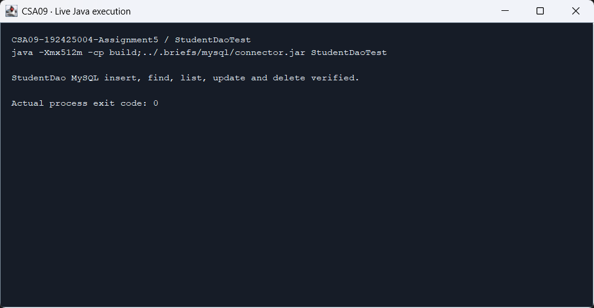

# TaskA3

[Written answers](ANSWERS.md) · [Test input](input/README.md)

Disposable student record 000090001, then insert, find, list, update and delete.

Build with the [repository instructions](../README.md), then execute from that repository root.

```powershell
java -cp "build;PATH_TO_CONNECTOR_JAR" StudentDaoTest
```

- [jdbc.txt](evidence/jdbc.txt)

## Genuine execution captures


