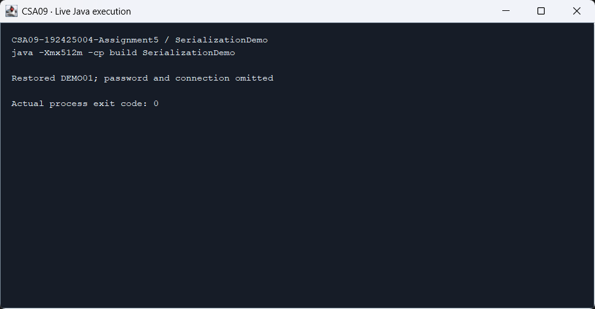

# TaskA4

[Written answers](ANSWERS.md) · [Test input](input/README.md)

Nested hostel, room and synthetic resident with transient runtime-only fields.

Build with the [repository instructions](../README.md), then execute from that repository root.

```powershell
java -cp build SerializationDemo
```

- [serialization.txt](evidence/serialization.txt)

## Genuine execution captures


