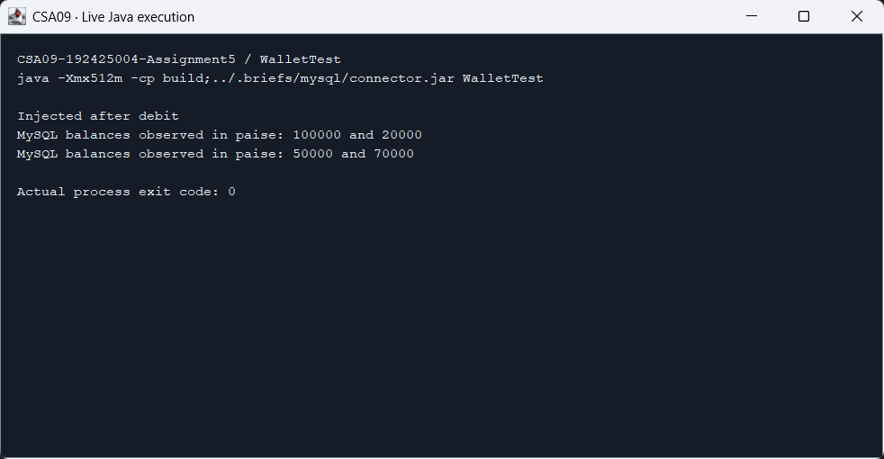

# TaskA5

[Written answers](ANSWERS.md) · [Test input](input/README.md)

Wallet 101 has 100000 paise, wallet 102 has 20000, transfer 50000 and inject a failure after debit.

Build with the [repository instructions](../README.md), then execute from that repository root.

```powershell
java -cp "build;PATH_TO_CONNECTOR_JAR" WalletTest
```

- [wallet.txt](evidence/wallet.txt)

## Genuine execution captures


