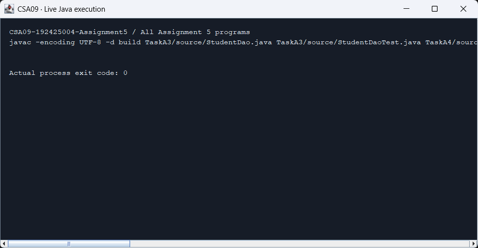
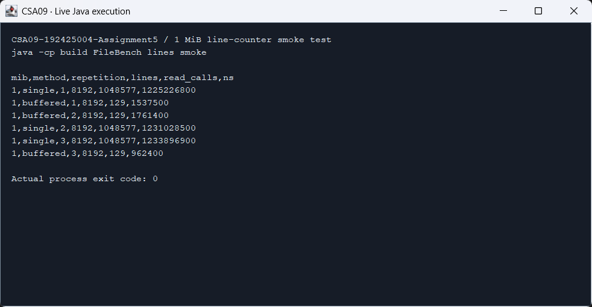
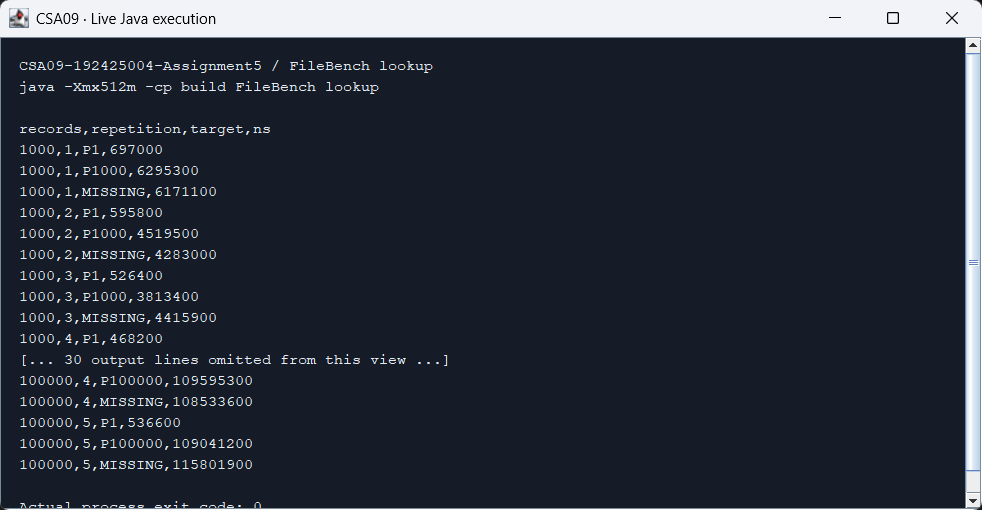
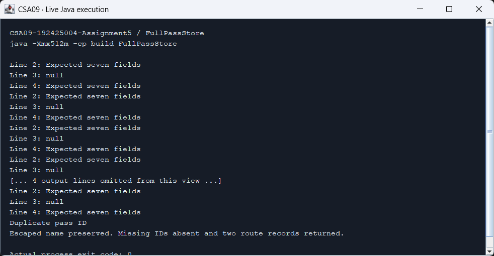
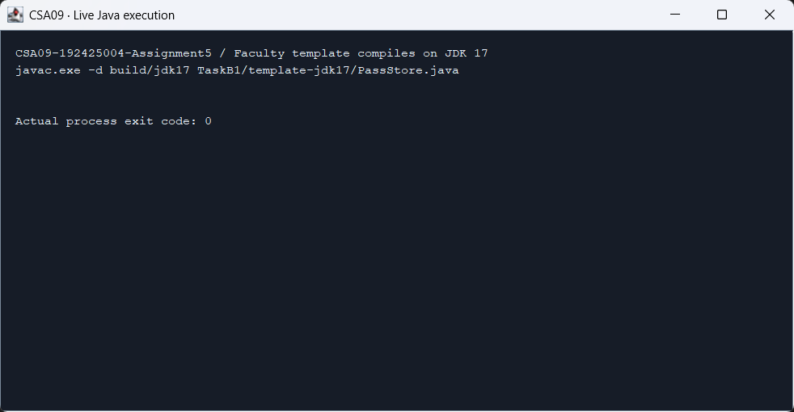
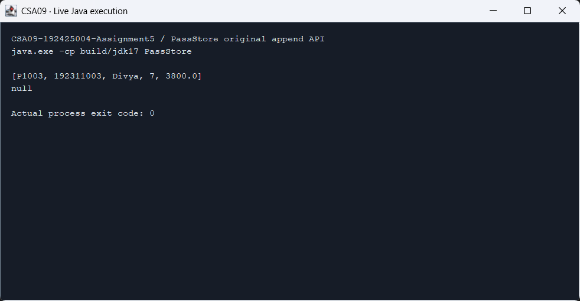
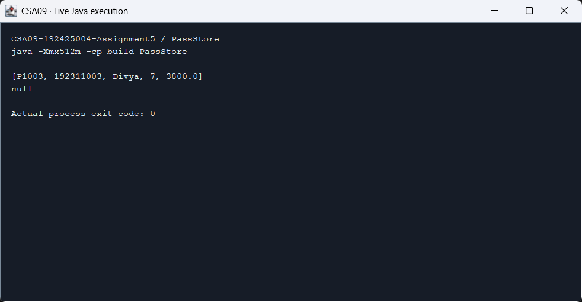

# TaskB1

[Written answers](ANSWERS.md) · [Test input](input/README.md)

Missing file, malformed rows, escaped name, duplicate and route results. 1/10/50 MiB log and 1k/10k/100k pass records.

Build with the [repository instructions](../README.md), then execute from that repository root.

```powershell
java -cp build PassStore
java -cp build FullPassStore
java -cp build FileBench lookup
java -cp build FileBench lines
java -cp build FileBench lines smoke
```

- [file-tests.txt](evidence/file-tests.txt)
- [jdk17-template.txt](evidence/jdk17-template.txt)
- [line-means.md](evidence/line-means.md)
- [line-smoke.csv](evidence/line-smoke.csv)
- [lines.csv](evidence/lines.csv)
- [lookup-means.md](evidence/lookup-means.md)
- [lookup.csv](evidence/lookup.csv)
- [todo.txt](evidence/todo.txt)

## Genuine execution captures














