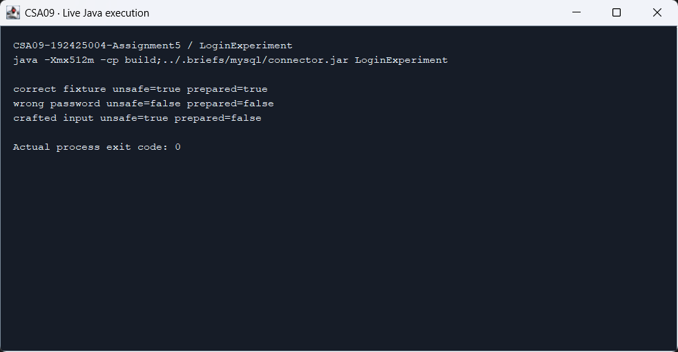

# TaskB2

[Written answers](ANSWERS.md) · [Test input](input/README.md)

Known fixture credential, wrong password and crafted identifier tested against local-only MySQL. Malformed rows also verified in B1.

Build with the [repository instructions](../README.md), then execute from that repository root.

```powershell
java -cp "build;PATH_TO_CONNECTOR_JAR" LoginExperiment
```

- [login.txt](evidence/login.txt)

## Genuine execution captures


