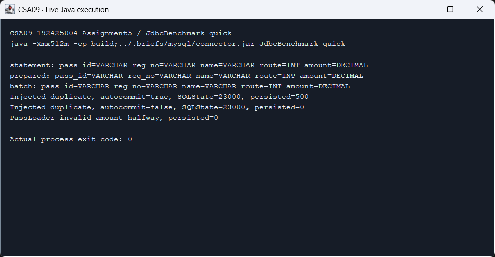
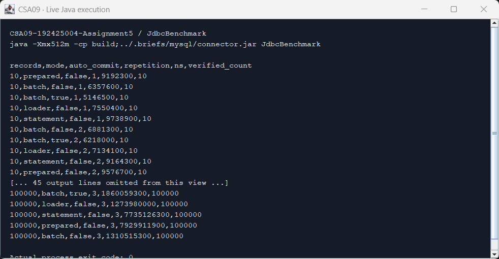

# TaskB3

[Written answers](ANSWERS.md) · [Test input](input/README.md)

Ten-row metadata and content fixture. 1k/10k/100k batch growth, duplicate at row 501 and invalid decimal.

Build with the [repository instructions](../README.md), then execute from that repository root.

```powershell
java -cp "build;PATH_TO_CONNECTOR_JAR" JdbcBenchmark quick
java -cp "build;PATH_TO_CONNECTOR_JAR" JdbcBenchmark
```

- [means.md](evidence/means.md)
- [raw.csv](evidence/raw.csv)
- [replicate.csv](evidence/replicate.csv)
- [verification.txt](evidence/verification.txt)

## Genuine execution captures




