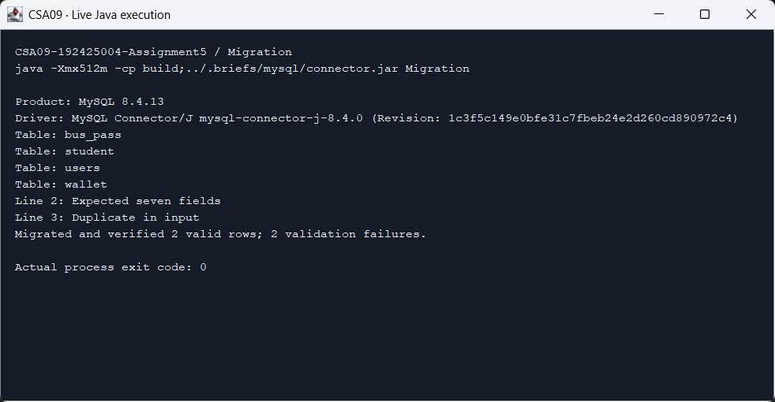

# TaskB4

[Written answers](ANSWERS.md) · [Test input](input/README.md)

Two valid escaped rows, a malformed line and a duplicate line. See passes.txt.

Build with the [repository instructions](../README.md), then execute from that repository root.

```powershell
java -cp "build;PATH_TO_CONNECTOR_JAR" Migration
```

- [migration.txt](evidence/migration.txt)

## Genuine execution captures


