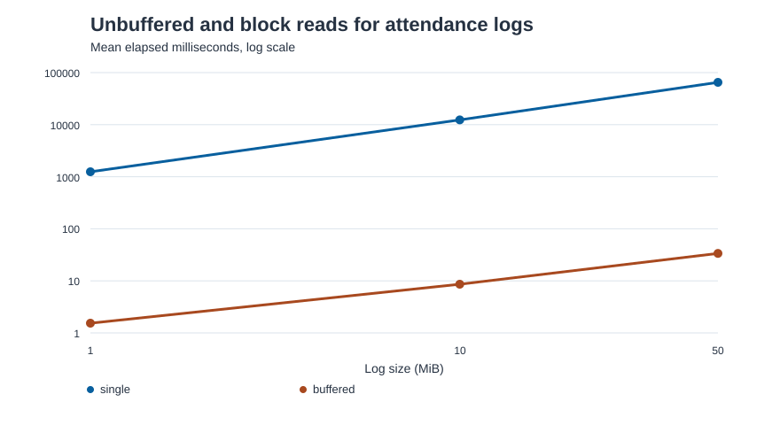
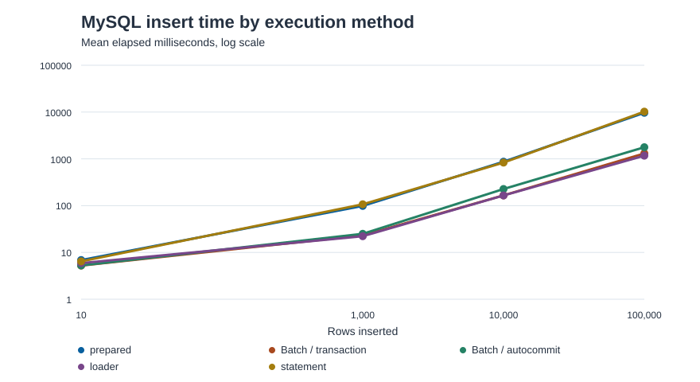

# CSA09 Programming in Java · Assignment 5

Aftan Faiz · 192425004 · CO5

GitHub repository [CSA09-192425004-Assignment5](https://github.com/AFTAN18/CSA09-192425004-Assignment5).

## TaskA1

### A1 · Bus-pass file format

#### A1.1 · Represent the record

UTF-8 text, one record per LF-terminated line, fields in this order: pass ID, register number, name, route number, boarding stop, ISO validity date, amount paid with two decimal places. Separate fields by |. Escape a literal | as \| and a literal backslash as \\. Reject literal control characters, including CR and LF, in field values. Example: P1|192311001|Asha\|Rao|7|North Gate|2027-03-31|3800.00. Preserve registration as text because leading zeroes may matter.

Binary version: a four-byte magic word and two-byte version followed by records. Each record is length-prefixed with a four-byte signed length constrained by a documented maximum, then pass ID, registration and name as DataOutputStream.writeUTF fields (two-byte modified UTF-8 byte length per field, maximum 65,535), route as four-byte signed int, boarding stop as writeUTF, validity as eight-byte signed epoch-day and amount as eight-byte signed minor units. Delimiters have no special meaning. A per-record CRC-32 can detect accidental payload corruption; verify record lengths and range before allocating.

#### A1.2 · Operations

```text
ALGORITHM AddPass(record, path)
    VALIDATE all fields
    ACQUIRE the store's exclusive writer lock
    IF FindPass(record.id, path) succeeds THEN RETURN duplicate
    APPEND escaped record and line terminator through buffered UTF-8 writer
    CLOSE writer
    RELEASE lock
END ALGORITHM

ALGORITHM FindPass(id, path)
    IF file does not exist THEN RETURN absent
    OPEN buffered UTF-8 reader
    FOR EACH line DO
        DECODE escape sequences and validate all fields
        IF damaged THEN record line number and CONTINUE
        IF record ID equals id THEN RETURN record
    END FOR
    RETURN absent
    CLOSE reader on exit
END ALGORITHM

ALGORITHM ListRoute(route, path)
    IF file does not exist THEN RETURN empty list
    OPEN buffered UTF-8 reader
    FOR EACH line DO
        DECODE and validate
        IF damaged THEN record line number and CONTINUE
        IF record route equals route THEN EMIT record
    END FOR
    CLOSE reader
END ALGORITHM
```

BufferedReader/BufferedWriter reduce calls while preserving charset and line boundaries. Java's Files factories let the program explicitly select UTF-8; FileReader/FileWriter in Java 8 otherwise use the platform default. FileInputStream/FileOutputStream are appropriate beneath binary data streams.

#### A1.3 · Damaged data and alternatives

Reject wrong field count, unsupported escapes, malformed dates, out-of-range values and invalid amounts. Record damaged line numbers and keep scanning. A missing file represents a new empty store. A power interruption can leave an unterminated tail or a syntactically plausible but incomplete record. A durable format uses checksums and record framing and verifies the tail before future appends. For replace operations, write and force a sibling temporary file, then atomically replace the destination where supported. For append, serialize writers, use a recoverable journal/frame and force the channel before reporting durability. The simple B1 fixture supports in-process writers and semantic row validation, with the durability design left as an extension.

Scan costs O(total bytes) time with O(maximum record length) extra reader memory, plus output. RandomAccessFile can seek to i × recordSize in O(1) indexed work given a known record ordinal, with O(recordSize) read work and scratch. Arbitrary pass IDs still need an ID-to-ordinal index or a scan. Fixed-width records waste the sum of unused bytes in padded fields and constrain strings. A separate map costs O(n) index space and supports expected O(1) lookup for bounded-length keys.

## TaskA2

### A2 · Buffered attendance-log scanning

For 50 decimal MB, one-byte reads make 50,000,001 Java read calls including EOF. For 50 MiB, as used in the experiment, the count is 52,428,801. FileInputStream.read generally crosses the Java/native boundary for each byte. System caching reduces physical I/O yet leaves per-call overhead. With an 8,192-byte buffer and full reads, 50 MiB takes 6,400 data reads plus EOF. Short reads can increase the count.

```text
ALGORITHM CountLines(input)
    SET lines ← 0 and sawBytes ← false
    WHILE reading into fixed byte buffer returns positive count DO
        FOR index FROM 0 TO count - 1 DO
            IF byte[index] equals LF THEN lines ← lines + 1
            last ← byte[index]
            sawBytes ← true
        END FOR
    END WHILE
    IF sawBytes AND last differs from LF THEN lines ← lines + 1
    RETURN lines
END ALGORITHM
```

This counts LF, including CRLF logs, and includes a final unterminated line. Empty input returns zero. Buffering offers little benefit for tiny files or when a caller already makes large reads through a buffered source. For B bytes, both scan and Files.readAllLines cost O(B) overall time. The byte scan uses O(buffer size) working memory. readAllLines materializes decoded text and per-line objects in O(B) space and is suitable if subsequent steps need the complete small file in memory. B1 measures both input methods with actual read-call counts.

## TaskA3

### A3 · Generic data access

#### A3.1

Open connection, prepare parameterized SQL, bind values, execute, map a result if applicable, and close result, statement and connection. Table/column names, parameter order, keys and field mapping vary. A shared connection provider can encapsulate configuration and pooling while each DAO owns its statements and row mapper.

#### A3.2

Dao<T,K> declares insert(T), findById(K), findAll(), update(T) and delete(K). StudentDao implements Dao<Student,String> and returns Optional for absent rows. It binds SQL values by type and uses try-with-resources. Update/delete report whether one row was affected. The generic interface describes operations rather than trying to construct SQL from type parameters.

#### A3.3

| Java | Column | Type |
|---|---|---|
| registration | reg_no | VARCHAR(20), primary key |
| name | name | VARCHAR(100), NOT NULL |

A UI with direct SQL must change every query and mapping referencing a renamed column. The DAO localizes these edits to its queries and mapping. The number may still be several statements in that DAO. Identical SQL plans cost the same asymptotically. An indexed lookup is roughly O(log n) database index work and O(1) result space for one row, plus network round trip. findAll is O(n) row work, transfer and materialized space. A DAO call adds constant local overhead.

## TaskA4

### A4 · Serialization

Mark password and live Connection transient. A password does not belong in a hostel backup and should be protected by separate authentication storage when used. A connection is a process-specific resource, opened on demand when restoring services. The serialization stream traverses Hostel → Room list → Room → Resident list → Resident. Reachable nontransient objects need serializable forms. References can preserve sharing and cycles. Static fields are class state.

With an explicitly matching serialVersionUID and compatible change, an old stream read into the class with a new reference field leaves phone null. Ordinary Serializable class field initializers do not supply a default for absent fields on deserialization. A compatible readObject or a migration can populate one. An incompatible UID gives InvalidClassException. Test old snapshots when changing persistent models. The runnable example only reads an in-process stream the same program created.

CSV flattens one row per resident and repeats room identity. Handle escaping and add a header column with a missing-value policy. JSON preserves nested rooms and tolerates absent optional keys under an explicit schema. Java serialization includes class descriptors and graph references, CSV is typically compact for flat data, and JSON repeats keys. No universal ordering by size holds. All take O(total encoded size) time for save/load under linear codecs and O(n) memory when constructing the full graph. Streaming CSV can process one row at a time. Text formats improve interoperability and explicit migration, while Java serialization is tightly coupled to Java classes.

## TaskA5

### A5 · Wallet transaction and login

#### A5.1 · Transfer

```text
ALGORITHM Transfer(source, target, amount)
    REQUIRE distinct wallet IDs AND amount = 50000 paise
    OPEN dedicated JDBC connection
    DISABLE auto-commit
    TRY
        LOCK both wallet records in ascending ID order
        IF either missing OR source balance < amount THEN FAIL
        DEBIT source using parameterized UPDATE and require one changed row
        CREDIT target using parameterized UPDATE and require one changed row
        COMMIT
    ON failure
        ROLLBACK
        REPORT failure, preserving rollback diagnostics
    END TRY
    CLOSE connection
END ALGORITHM
```

Before commit, transactional rollback restores both rows after a statement error or disconnect. A lost commit acknowledgement requires an idempotency key or reconciliation before retrying. Separate autocommit statements can leave the debit permanently applied if failure precedes credit. Both do two writes plus indexed lookups. A transaction may add lock and commit overhead but can amortize durability work into one commit. Auxiliary app space is O(1); database logging/locking is bounded for the two-row example.

#### A5.2 · Injection

Concatenating an ID that closes a string and introduces OR 1=1, followed by a MySQL comment marker with required whitespace, can bypass the password predicate. Parameterize the ID and applicable password lookup so data cannot become SQL syntax. The assignment's disposable demonstration compares literal fixture passwords to show the difference. A real authentication implementation should retrieve a password hash by ID and verify it separately.

## TaskB1

### B1 · File store and measurement

The full store transfers the seven-field design from A1 to UTF-8. One object serializes additions through its instance monitor. find reads until match and route visits all valid records. The fixture checks a missing file, escaped delimiter/backslash, two good rows, a wrong field count, an invalid amount, a blank line, a missing ID and duplicate rejection. Malformed rows emit a numbered diagnostic and scanning continues. This fixture does not implement multi-process locking or a crash journal.

The original shorter PassStore uses the five-field CSV compatibility exercise. The clipped P1001 line is restored with an illustrative amount because it never affects the two printed results. The supplied `Files.writeString` is represented on Java 8 with an equivalent UTF-8 byte append. The TODO skips records with the wrong field count, so P1002 cannot abort the lookup for P1003. The full implementation additionally validates numeric and date fields.

The timing fixture builds exact 1, 10 and 50 MiB logs using 128-byte LF-terminated rows. Each method is sampled three times per size and compared for exact counts. Actual Java read-call counts include EOF. It also verifies empty and unterminated inputs. Timed lookup uses 1,000, 10,000 and 100,000 records with first, last and missing IDs. It samples five times after two warmups. File generation is outside the timed sections. Warm OS cache affects throughput, while per-call overhead remains visible.

For q lookups over n similarly-sized records, repeated scans use O(qn) worst-case time and O(maximum row length) working space. Loading valid rows once into a HashMap and applying a deterministic duplicate policy takes O(n) expected time and O(n) retained entries, then expected O(q) additional lookup work for bounded length keys. The map must be kept current on writes. Route output materialization uses O(k) records for k matches.

At 50 MiB, the one-byte method used 52,428,801 read calls and averaged 65,093.22 ms. The block method used 6,401 calls and averaged 33.73 ms. These are Java read calls, not independently traced OS calls. At 100,000 rows the final-ID and absent-ID scans averaged 118.24 and 119.73 ms, respectively. The first-ID path stopped after one record. See both means tables and the raw CSV files.

The full 1, 10 and 50 MiB benchmark is recorded in lines.csv. Its long repeat finished while the desktop returned a black capture, so the saved interactive screenshot uses a separate real 1 MiB run. Launch it with java -cp build FileBench lines smoke.

## TaskB2

### B2 · Adversarial inputs

The Java demo is restricted to the dedicated csa09_persistence database on loopback and touches an illustrative account. The crafted ID terminates the quoted literal, OR 1=1 makes the WHERE predicate true, and the comment marker hides the remaining password comparison. The prepared query binds the entire text as one ID value and finds no match. The positive control accepts a known fixture, and both reject a wrong password when the input is ordinary.

The full pass store test emits line numbers for a wrong field count, a nonnumeric amount and a blank line, skips them and still finds a later valid record. See B1's captured file test. This is important because a syntactic row shape alone does not validate the business fields.

A regular expression can enforce a business ID alphabet but is context-specific and constrains legitimate text. Escaping must follow driver, character encoding and SQL mode for the applicable context, and manual escaping is easy to omit. Binding addresses SQL interpretation directly and allowlisting can remain independent validation. Basic scanning validation or escaping and parameter encoding all take O(L) work in input length L. Copying escaped text may need O(L) additional memory. Network, server parsing and caching dominate many queries.

## TaskB3

### B3 · MySQL insert experiments

#### B3.1 · Correctness

For each mode, clear only the disposable table, insert the same ten generated passes and SELECT the ordered keys. Assert every field, no extra row and five expected JDBC column types using ResultSetMetaData. The benchmark applies the same check to counts at larger sizes.

#### B3.2 · Growth

Use 10, 1,000, 10,000 and 100,000 generated passes, rotating execution order. A warmup is followed by three measured repetitions. Dataset construction, table truncation and verification are outside the timed region. Times include statement creation, binding or SQL construction, execution and commits. Batch size is 500. Each baseline uses one transaction so auto-commit is a separate experiment. Local Connector/J uses rewriteBatchedStatements=true.

#### B3.3 · Atomicity

Force a duplicate first key at row 501. With auto-commit the earlier successful batch persists. With a single transaction all rows roll back. The completed PassLoader also binds an invalid decimal halfway through its fixture, after one executed batch. It must roll back to zero rows. It expects a dedicated connection to avoid committing caller-owned work.

#### B3.4 · Trade-offs

For a counter issuing one pass, use one prepared statement with a small transaction as needed for associated updates. For nightly imports use prepared batches under an explicit transaction or staged chunks with clear restart behavior. The fixed-size batch reduces round trips and repeated parsing compared with individual statements. A multi-row SQL string groups rows and should bind parameters for each row, respecting packet limits. LOAD DATA uses server-side bulk parsing and needs staging, file access and validation design. Each loads at least O(n) rows. Batching with b rows uses O(b) parameter staging, plus O(n) Java fixture storage in this benchmark and database log/index cost. A single huge statement would require O(n) SQL space and can exceed limits.

At 100,000 rows, Statement averaged 10,184.39 ms, per-row PreparedStatement 9,642.81 ms, transactional prepared batch 1,302.62 ms, autocommit batch 1,770.19 ms and the completed loader 1,169.53 ms. With the injected duplicate, the observed remaining counts were 500 under autocommit and 0 inside a transaction. The invalid decimal in the loader also left 0 rows. Repeating the full benchmark produced a second dataset in evidence/replicate.csv.

## TaskB4

### B4 · Migration and scale decision

#### B4.1 · Migration

```text
ALGORITHM MigratePasses(input, rejects)
    OPEN dedicated connection and disable auto-commit
    FOR EACH numbered input line DO
        PARSE and validate fields and detect repeated input keys
        IF invalid THEN WRITE rejection with line number AND CONTINUE
        BIND seven fields and add to batch
        IF batch reaches 500 THEN execute batch
    END FOR
    EXECUTE final partial batch
    FLUSH validation report
    COMMIT all valid inserts, or ROLLBACK on database/system failure
END ALGORITHM
```

The fixture sends two valid lines, one malformed line and one duplicate key in the input. It checks all fields that were absent from the five-field teaching template and captures two validation messages. An existing server-side primary-key conflict rolls back the valid import. For multiple importers, stage with import-run IDs and reconcile duplicates transactionally. The single input-ID set takes O(n) worst-case client space. SQL parameter staging uses O(b) for b batch rows.

#### B4.2 · Metadata

DatabaseMetaData reports actual product, server version, driver and tables. Compare these to deployment requirements and help diagnose server/driver or missing-schema issues without assuming vendor and version. This program requires MySQL and uses its SQL dialect.

#### B4.3 · Decision

Use one logical database for twelve campuses, with a stable global key or composite campus/pass ID, indexed by route and campus, durable writes, transactions, least-privilege roles, backups and observed load tests. The 8,000-per-year baseline scales to roughly 800,000 per year. B1's measured tail/miss scan grows with file size. B3's real batch timings establish feasibility for loading 100,000 rows on this local fixture. They do not establish throughput for independent production sites. Index lookups are roughly O(log N) plus network, and route reports are roughly O(log N+k) with k matches and a matching index. The database stores O(N) rows and O(N) index entries, plus logs and working caches.

Twelve separate serialized campus files need a local writer protocol and atomic file replacement. Searching all files is O(N) record work without a global index. Parallel materialization may use O(N) memory, while processing one campus at a time uses O(max campus records), plus results. Concurrent counters need cross-process locking or a single writer and reliable coordination across sites. Database uniqueness and transactional concurrency directly represent those requirements.

## Completion checklist

- [x] All Part A designs and Part B implementations.
- [x] File format and line-count tests, raw timings and averages.
- [x] Local MySQL injection, commit-and-rollback, migration and metadata experiments.
- [x] Original Java 17 append API variant verified.
- [x] Captured program evidence. The full 1, 10 and 50 MiB benchmark is recorded in lines.csv. Its long repeat finished while the desktop returned a black capture, so the saved interactive screenshot uses a separate real 1 MiB run. Launch it with java -cp build FileBench lines smoke.

## Measured comparisons




